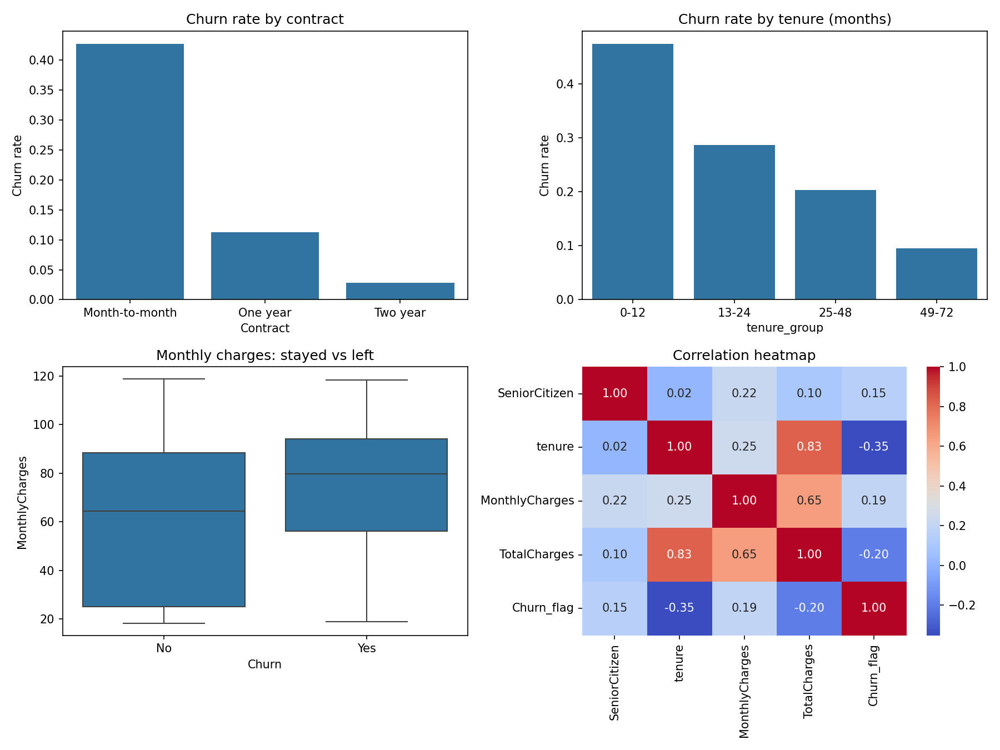

# Telco Customer Churn Analysis (SQL + Python)

## Business question
Which customers leave, and when? Where should a telecom company focus its retention effort?

## Dataset
Telco Customer Churn (IBM sample data, via Kaggle, by BlastChar): 7,043 customers, 21 columns. One row is one customer. `Churn` shows whether the customer left.

## What I did
1. **Cleaned the data (Python, Pandas):** found 11 blank `TotalCharges` values hidden as text; all belonged to new customers with tenure 0, so I filled them with 0. Confirmed 0 duplicate rows and 0 duplicate customer IDs. Created a `Churn_flag` column (1 = left, 0 = stayed).
2. **Explored churn by group:** contract type, tenure band, internet service and payment method, with bar charts, a boxplot and a correlation heatmap (Seaborn).
3. **SQL analysis (SQLite):** 6 queries using GROUP BY, CTEs, RANK(), ROW_NUMBER(), PARTITION BY and a running total. See `queries.sql`.

## Key findings
- Overall churn was **26.54%** (1,869 of 7,043 customers).
- **Month-to-month** customers churned at 42.7%, vs 11.3% on one-year and 2.8% on two-year contracts.
- The riskiest segment was **Month-to-month + Fiber optic**: 54.6% churn across 2,128 customers.
- **Fiber optic churned more than DSL inside every contract type** (54.6% vs 32.2%, 19.3% vs 9.3%, 7.2% vs 1.9%).
- **55.5% of all churn (1,037 customers) happened in the first 12 months**, and 20.3% at tenure 1.
- **Electronic check** had the highest churn inside every contract type (for example 53.7% vs 31.6% to 34.1% on month-to-month).

## Recommendation
Focus retention effort on new, month-to-month customers, especially fiber optic customers and those paying by electronic check.

## Limitations
- This is observational data: it shows patterns, not causes. For example, it does not explain why fiber customers churn more.
- No price, competitor or service-quality data was available.
- I did not test any retention action, and I did not build a prediction model.
- SQL was run in SQLite; the queries use standard SQL.

## Tools
Python, Pandas, Seaborn, Matplotlib, SQL (SQLite), Google Colab / Kaggle Notebooks.

## Files
- `telco-churn.ipynb`: Python analysis and SQL queries
- `queries.sql`: the 6 SQL queries
- `telco_cleaned.csv`: cleaned dataset
- `churn_eda.png`: charts
